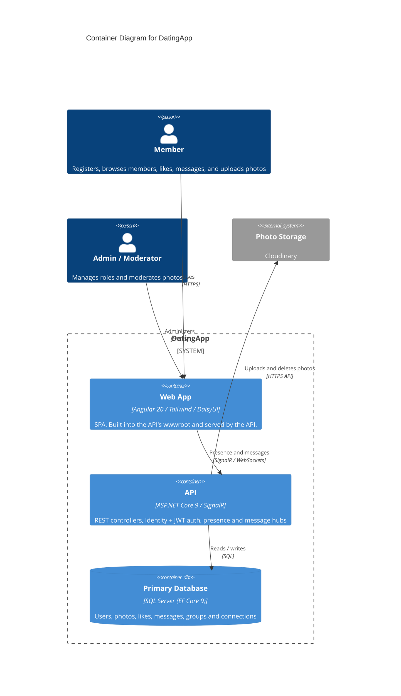

# Container Diagram — DatingApp

> **C4 Level 2**: the system broken down into runnable units.

## Diagram

> **Note**: this diagram was auto-generated by /handover on 2026-10-16 from repo signals (`API.csproj`, `client/package.json`, `docker-compose.yml`, `Program.cs`). It is a **starting point**. Review and refine:
>
> - Container labels and tech strings: the detector may have picked a framework version wrong
> - Inferred relationships: user → web assumes HTTPS. Adjust if your stack uses something else.
> - External systems: anything your team uses that isn't in `client/package.json` or `API.csproj` won't have been detected. Examples are infra-only dependencies and cloud APIs called over HTTP.
>
> Update the "Maintenance" section below once the diagram is stable.

## Maintenance

(From the template. Update when L2 containers change.)
