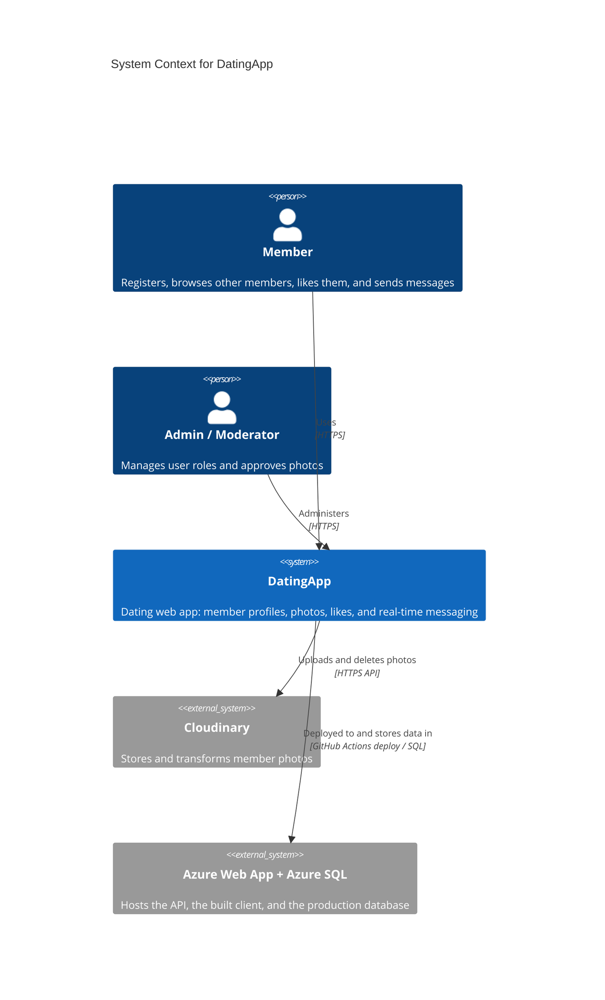

# System Context — DatingApp

> **C4 Level 1**: the system and everyone and everything it talks to.

## Diagram

> **Note**: this diagram was auto-generated by /handover on 2026-10-16 from repo signals (`API.csproj`, the GitHub Actions workflow, and the README). It is a **starting point**. Review and refine:
>
> - Azure is the original author's hosting. A copy of this repo needs its own target.
> - No email, payment, or third-party auth provider was detected. Identity runs inside the API.
>
> Update the "Maintenance" section below once the diagram is stable.

## Maintenance

(From the template. Update when the system's external relationships change.)
