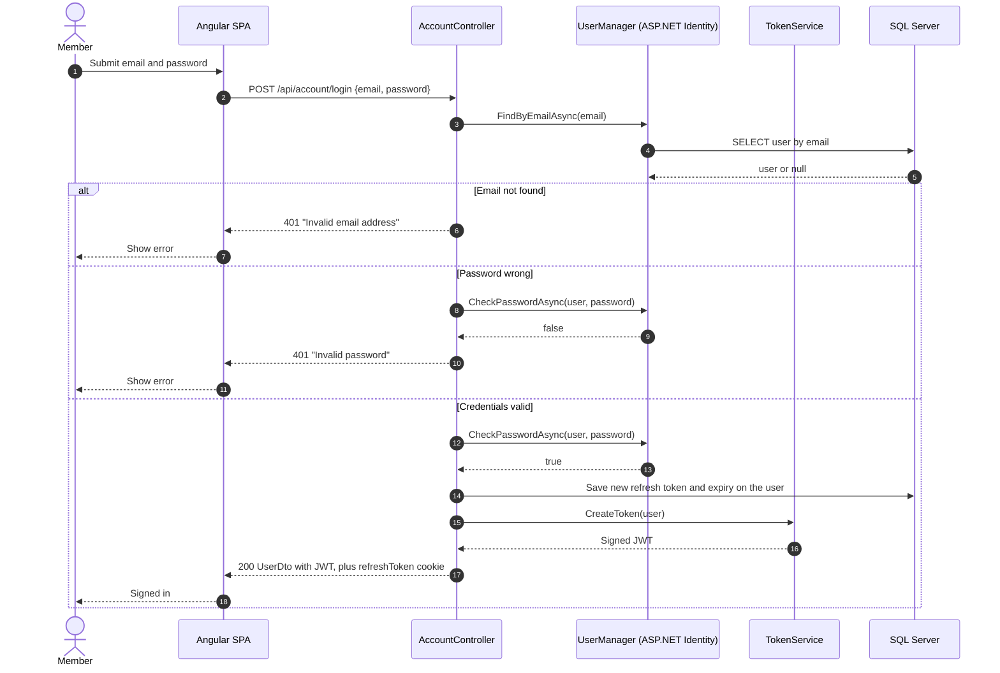

# Sequence Diagram — Login

> The login flow in `API/Controllers/AccountController.cs` (`POST api/account/login`). It issues a JWT access token and sets a refresh-token cookie.

## Diagram

> **Note**: this diagram was auto-generated by /handover on 2026-10-16 from a static read of `AccountController.cs`. It is a **starting point**. Review and refine.
>
> - The two 401 responses use different messages. This lets an attacker find registered email addresses. See the handover assessment's Security section.
> - The order of the refresh-token save and the JWT creation follows the code (`SetRefreshTokenCookie`, then `ToDto`). The internals of `ToDto` were not traced.

## When this flow runs

- A member submits the login form in the Angular client.
- Session renewal uses a separate endpoint, `POST /api/account/refresh-token`. It reads the cookie instead of the credentials.

## Maintenance

Update this diagram when the login endpoint, token creation, or the refresh-token handling changes.
