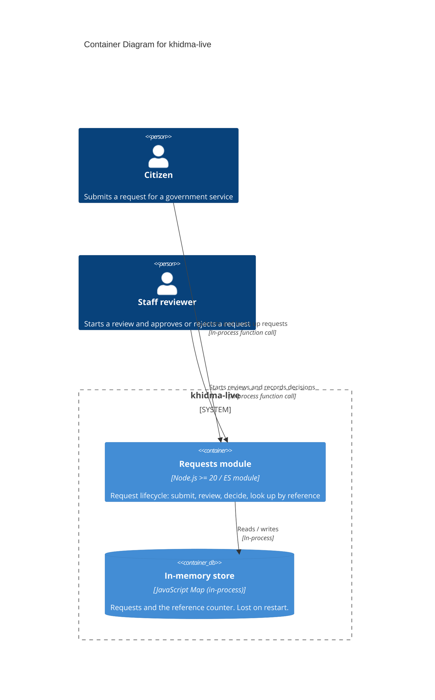

# Container Diagram — khidma-live

> **C4 Level 2**: the system broken down into runnable units. khidma-live has one runnable unit today: a Node.js module with an in-process store.

## Diagram

> **Note**: this diagram was auto-generated by /handover on 2026-10-16 from repo signals (package.json, Dockerfile, docker-compose.yml, Prisma schema, .env.example). It is a **starting point**. Review and refine:
>
> - Container labels and tech strings: the detector may have picked a framework version wrong
> - Inferred relationships: the repo has no HTTP layer, so people reach the module only through calling code (today, the tests)
> - External systems: anything your team uses that isn't in package.json won't have been detected
>
> Update the "Maintenance" section below once the diagram is stable.

## Maintenance

(From the template. Update when L2 containers change.)
