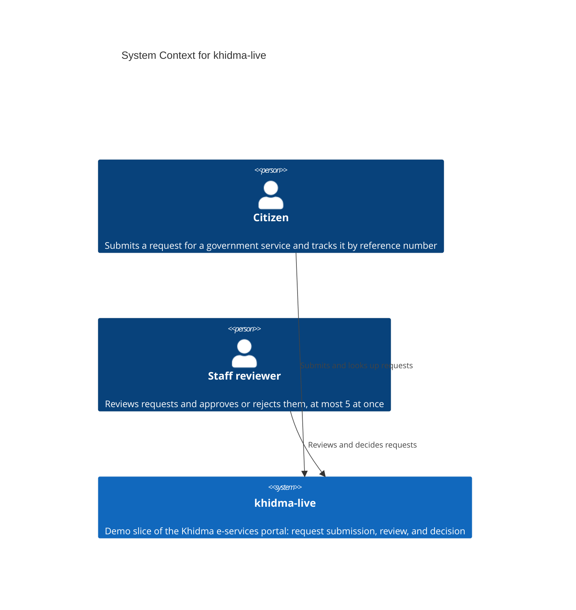

# System Context — khidma-live

> **C4 Level 1**: the system and everyone it talks to.

## Diagram

> **Note**: this diagram was auto-generated by /handover on 2026-10-16 from repo signals. It is a **starting point**. Review and refine:
>
> - No external systems were detected. The repo has no dependencies and no network calls.
> - The relationships have no protocol label because the repo has no HTTP or UI layer yet.
>
> Update the "Maintenance" section below once the diagram is stable.

## Maintenance

(From the template. Update when the system's external relationships change.)
